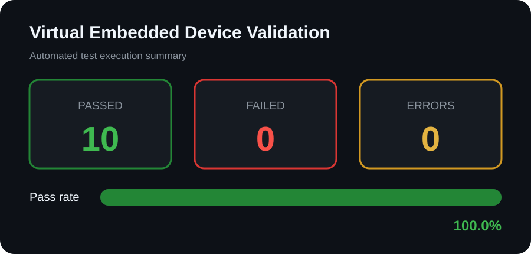

# Virtual Embedded Device Validation Framework
[](https://github.com/Sathwick-kesagani/virtual-embedded-validation-framework/actions/workflows/validation.yml)


A Python-based automated validation framework for a simulated embedded device.  
The project demonstrates embedded-system testing, fault injection, GPIO
verification, sensor validation, test automation, and report generation without
requiring physical hardware.

> This is a software simulation project. It does not claim testing on physical
> embedded hardware.

## Validation Results



The current automated test run completed with:

- **10 tests passed**
- **0 tests failed**
- **0 execution errors**
- **100% pass rate**

See the complete [validation report](VALIDATION_REPORT.md).

## Features

- Simulated embedded-device command interface
- Communication and device-information checks
- Digital GPIO write and read-back verification
- Invalid GPIO input handling
- Simulated temperature, voltage, and current measurements
- Deterministic sensor behavior for repeatable testing
- Heartbeat counter verification
- Controlled fault injection
- Disconnected-sensor detection
- Overtemperature detection
- Undervoltage detection
- Automated test execution
- CSV test-result generation
- Markdown validation reporting
- SVG test-summary visualization

## System Architecture

```text
+------------------+       Commands        +--------------------------+
| Automated Test   | --------------------> | Virtual Embedded Device  |
| Runner           | <-------------------- | Simulator                |
+------------------+       Responses       +--------------------------+
         |
         | writes
         v
+------------------+       processed by    +--------------------------+
| test_results.csv | --------------------> | Report Generator         |
+------------------+                       +--------------------------+
                                                     |
                                                     v
                                   +----------------------------------+
                                   | SVG Summary and Markdown Report  |
                                   +----------------------------------+
```

## Automated Test Coverage

| Test ID | Validation scenario |
|---|---|
| TC-001 | Communication ping |
| TC-002 | Device information |
| TC-003 | Set and read GPIO high |
| TC-004 | Set and read GPIO low |
| TC-005 | Reject invalid GPIO value |
| TC-006 | Nominal sensor range |
| TC-007 | Disconnected-sensor detection (fault injection) |
| TC-008 | Overtemperature fault detection (fault injection) |
| TC-009 | Undervoltage fault detection (fault injection) |
| TC-010 | Heartbeat counter |

## Project Structure

```text
virtual-embedded-validation-framework/
├── .github/workflows/validation.yml   # CI: runs the suite on every push
├── device_simulator.py                # Virtual embedded device + fault injection
├── test_runner.py                     # Automated test suite (TC-001 to TC-010)
├── report_generator.py                # Builds the SVG summary and Markdown report
├── test_results.csv                   # Latest results
├── test_summary.svg                   # Results dashboard
├── VALIDATION_REPORT.md               # Full validation report
├── README.md
└── LICENSE
```

## How to Run

Requires Python 3.10 or newer. No external packages are needed (standard library only).

```bash
git clone https://github.com/Sathwick-kesagani/virtual-embedded-validation-framework.git
cd virtual-embedded-validation-framework

# Run the automated validation suite (exits with code 1 if any test fails)
python3 test_runner.py

# Generate the SVG summary and Markdown report
python3 report_generator.py
```

Example output:

```text
TC-001: Communication ping                     PASS
...
TC-010: Heartbeat counter                      PASS
Passed: 10  Failed: 0  Errors: 0  Total: 10
```

## Continuous Integration

GitHub Actions runs the full suite and report generator on every push and pull
request to `main`, and uploads the CSV, SVG and Markdown reports as build
artifacts. A failing test fails the build.

## Future Improvements

- Run the same test suite against a physical microcontroller over UART
- Add timing and response-latency checks
- Add a pytest-based version of the suite

## Author

**Sri Sathwick Kesagani** · M.S. Electrical and Computer Engineering, University of Hartford ·
[LinkedIn](https://www.linkedin.com/in/sri-sathwick-kesagani-658055432)
